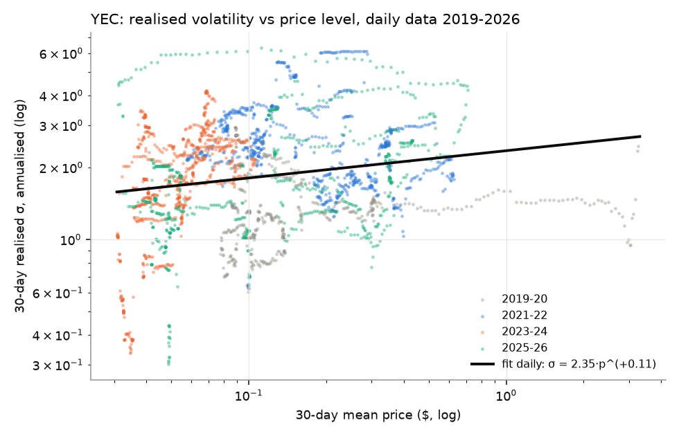
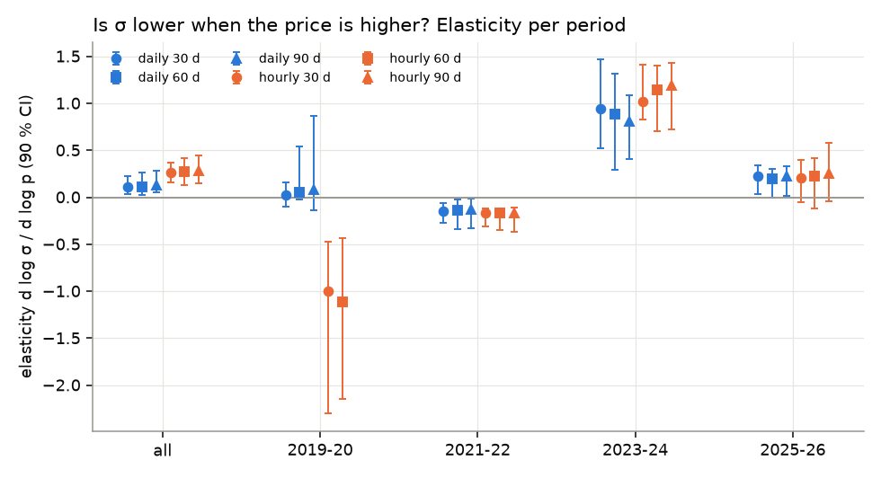
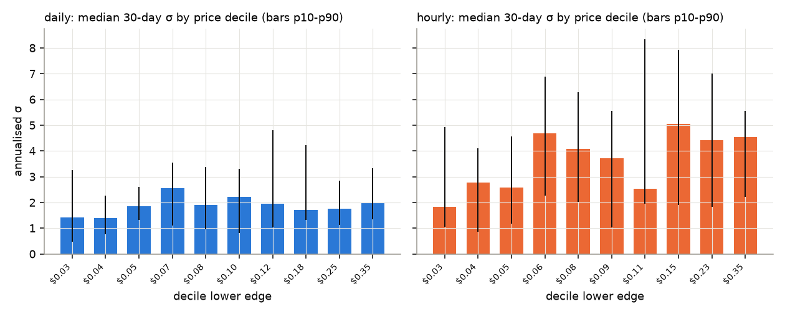
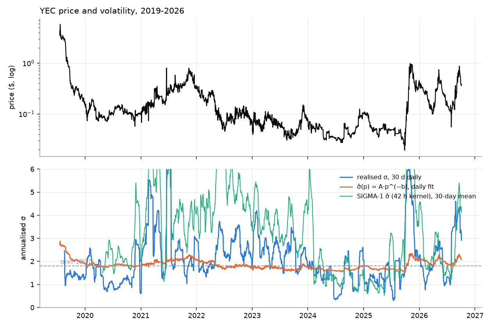
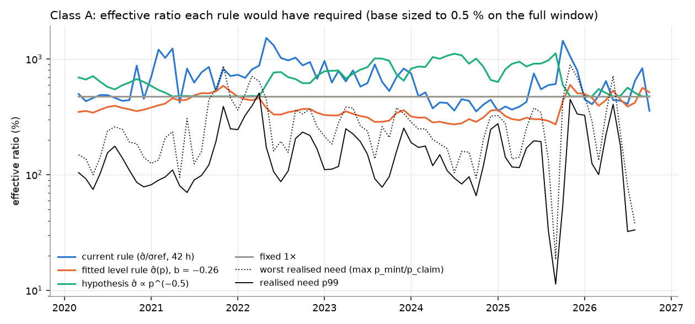

# Volatility vs price level: does YEC's σ fall as its price rises, and should the ratio rule read the price?

**Study of the owner hypothesis of 2026-10-07**, on the frozen snapshot `data/local/frozen-20261004`
(`yec-daily.csv` 2019-07-20 → 2026-10-04, 2,634 rows; `yec-hourly.csv` 2020-03-26 → 2026-10-04,
57,182 rows; `SHA256SUMS` verified by the study before reading; nothing fetched). Code:
`src/ybcal/studies/vol_price_level.py` (pure numpy/scipy, 4 s). Figures and CSVs sit next to this file;
every table below is also in [`tables.md`](tables.md) / `*.csv`.

**Hypothesis as stated.** Percentage volatility of YEC is high because its price and market cap are
low; as the price rises, percentage volatility should fall, so bad-debt risk falls; a price-level-aware
transform such as log(p+1), applied consistently at minting and redemption, might smooth the risk.

**Framing (stated up front).** The collateral maths is in percentage returns and is scale-free: a vault
minted at `pMint` is bad at claim opening iff `ratio_eff < pMint / pClaim`, a ratio of prices. Taking
`log(p+1)` (or any transform) of both prices changes nothing by itself, and Spearman correlations are
identical for every monotone transform of `p`. The only testable content of the hypothesis is **whether σ
depends on the price level** (or on cap, volume, depth). If it does, a rule can read the level; if it does
not, no transform helps.

## Verdict in one paragraph

**The relation is real but has the opposite sign to the hypothesis, is weak, and is not stable.** Over
YEC's whole history realised σ is *higher* when the price is higher (full-sample elasticity
`d log σ / d log p` = **+0.11** on daily 30-day windows, 90 % block-bootstrap CI +0.03…+0.22; **+0.26** on
hourly, CI +0.16…+0.37; Spearman +0.18 / +0.36; R² ≤ 0.17). The sign flips between sub-periods
(2021-22: −0.15; 2023-24: +0.9 to +1.2; 2025-26: +0.2), so it is not a structural law but an artefact of
how YEC reaches high prices: by pumps, which are the volatile episodes, followed by −72 % (2021) and −94 %
(2025-26) drawdowns. A rule built on the hypothesised direction (σ̂ ∝ p^(−b), b > 0) **lowers the ratio
exactly where the historical bad debt occurred** (mints near the 2021-11 and 2025-11 peaks) and, sized to
the same 0.5 % tolerance, costs minters a *higher* time-average ratio than a fixed multiplier (700 % vs
475 % on the full window). The strongest finding is a side effect: **today's 42-hour realised-σ multiplier is
backward-looking and noisy** — it needs a 350 % base but makes minters face a 666 % average (p90 1,416 %)
while leaving 11 % of class-A mints bad in 2022-04 and 2026-05, and a flat 475 % does the same job cheaper on
the real path. No price-level rule is recommended; the ratio-rule question that is worth the owner's time
is the estimator's window, not the price level (§4).

## 1. Realised volatility vs price level

Method: log returns; rolling 30/60/90-day σ annualised (√365 daily, √8,760 hourly); the level is the
window's geometric-mean price; OLS of log σ on log p with a moving-block bootstrap (block = one window,
300 reps) for the CI, because consecutive rolling windows overlap and plain standard errors are far too
small; `b | time` adds a linear time trend as a control. Sub-periods by the window's end date (hourly data
starts 2020-03, so hourly "2019-20" is 2020 only).





| series | window | period | n | Spearman | elasticity b | 90 % CI | b \| time | R² | median σ |
|---|---|---|---|---|---|---|---|---|---|
| daily | 30 d | all | 2,604 | +0.175 | **+0.114** | +0.03 … +0.22 | +0.128 | 0.035 | 184 % |
| daily | 90 d | all | 2,544 | +0.247 | +0.128 | +0.05 … +0.28 | +0.150 | 0.061 | 204 % |
| hourly | 30 d | all | 56,478 | +0.355 | **+0.261** | +0.16 … +0.37 | +0.229 | 0.122 | 361 % |
| hourly | 90 d | all | 55,038 | +0.439 | +0.283 | +0.15 … +0.44 | +0.238 | 0.169 | 400 % |
| daily | 30 d | 2019-20 | 501 | +0.192 | +0.027 | −0.10 … +0.16 | −0.025 | 0.005 | 132 % |
| daily | 30 d | 2021-22 | 730 | −0.291 | **−0.147** | −0.27 … −0.07 | −0.229 | 0.055 | 242 % |
| daily | 30 d | 2023-24 | 731 | +0.543 | **+0.946** | +0.52 … +1.47 | +0.571 | 0.319 | 189 % |
| daily | 30 d | 2025-26 | 642 | +0.342 | +0.223 | +0.03 … +0.34 | +0.069 | 0.118 | 172 % |
| hourly | 30 d | 2021-22 | 17,520 | −0.375 | −0.166 | −0.32 … −0.12 | −0.166 | 0.098 | 504 % |
| hourly | 30 d | 2023-24 | 17,544 | +0.631 | +1.015 | +0.83 … +1.41 | +0.539 | 0.372 | 301 % |
| hourly | 30 d | 2025-26 | 15,390 | +0.262 | +0.210 | −0.05 … +0.40 | +0.057 | 0.080 | 246 % |

All 30 fits (both series × three windows × five periods) are in `level_fits.csv`. Reading:

- **Sign.** Positive overall and in 2023-26; negative only in 2021-22 (the year after the 2021 pump, when
  the price drifted down while σ stayed high) and in the hourly 2020 stub (6k points, CI −2.3…−0.5, the
  COVID-March spike at the lowest prices). The hypothesis predicts a *negative* elasticity everywhere.
- **Strength.** Weak: Spearman 0.18–0.44 overall; R² of the log-log fit 3–17 %. Even the within-period
  2023-24 fit (R² 0.32–0.63) is a single episode: a slow drift down to $0.03 with falling σ, then the 2025
  pump with rising σ — i.e. "price up ⇒ σ up", the opposite of the claim.
- **Time control.** Adding a time trend leaves b at +0.13 (daily) / +0.23 (hourly): the positive relation is
  not a proxy for "later = calmer".
- **Deciles** (fig 2, `deciles_*.csv`): daily median 30-day σ is **143 %** in the lowest price decile
  ($0.031–0.041) and **197 %** in the highest ($0.35–3.25); hourly 184 % → 454 %. No decile is below 140 %.
  Nothing resembles the "1 % at $100" intuition; YEC's range is $0.03–$0.98 (2020-26), one and a half
  decades, and σ moves by a factor ≈ 1.4 across it, upward.





**Volume, depth, cap, BTC.** The daily file carries 24 h volume for 249 days only (2019-08 → 2020-04),
Spearman(σ, volume) −0.33 there — a small early sample. The hourly file carries volume for the last 365
days only (CoinGecko segment, n = 8,760): Spearman(σ, volume) **+0.49**, but volume and price are
collinear (ρ = 0.83) and the joint regression gives elasticities of −0.93 (price | volume) and +0.89
(volume | price): one year, one pump, not separable. `depth.csv` is a single order-book snapshot
(2026-10-04), so depth-vs-σ has no history to test. Market cap ≈ price × circulating supply with a
smooth, monotone emission, so a cap-level test is rank-equivalent to the price test on this horizon.
**No BTC or other large-asset series is in the frozen data, so the "BTC's σ fell as its cap rose"
comparison is out of scope**; the mechanism it names (depth and holder base growing with cap over years)
is not what moved YEC's price, which moved by pump-and-crash within months.

## 2. What it implies for a ratio rule: backtest on the real path

**Bad-debt definition** — the G3 study's (`ybcal.sim.metrics.p_bad_debt_fast`): a vault of `cents` minted
at hour `s` holds `collateral = ceil(cents · ratio_eff · COIN / pMint)`; the claim path opens at
`e = s + ceil((T + grace + 1) / 48)` hours; the vault is **bad iff `collateral · price(e) < debt`**
(`is_underwater` at 100 %); P(bad) averages every start hour after warm-up and an equal-probability grid of
16 lock terms of the class (class A 34,560–103,680 blocks = 30–90 days; grace 34,560 = 30 days; so the
test looks 60–120 days ahead of every mint). Differences from the G3 harness, deliberately: the *real*
hourly path only (no bootstrap/regime ensembles), `pMint = pClaim-time true price = market price` (ideal
oracle), and the σ̂ fed to each rule is SIGMA-1's exact integer kernel (`vkernels.sigma_mult_series`) run on
the hourly price as pFast — volWindow 2016 / volStep 48 at mainnet is **42 hourly returns**, annualised
with 8,760. The float shortcut `ratio_eff < ceil(10^4·pMint/pClaim)` was spot-checked against the exact
integer kernels (`wallet_collateral` at $1,000, 1,000-zat rounding, `is_underwater`) on 2,000 random
cells: **0 disagreements**.

Rules compared (multiplier per mint hour, then `ratio_eff = base · mult // 10^4` as MINT-5 does), all
with the H-3 pins σref = 18,000 bps, cap = 47,500 bps (the shipped 10,000 / 30,000 pair is in the CSV):

| rule | multiplier |
|---|---|
| `current` | SIGMA-1 today: clamp(σ̂₄₂ₕ / σref, 1, cap) |
| `level-insample` | σ̂(p) = 6.00 · p^(+0.26) fitted on the whole hourly history (look-ahead; the best case for a level rule) |
| `level-to2022` | σ̂(p) = 4.74 · p^(+0.04) fitted on 2020-22 only (honest out-of-sample for 2023-26) |
| `blend-max` / `blend-geo` | max / geometric mean of σ̂₄₂ₕ and the in-sample σ̂(p) |
| `hypothesis-b0.5`, `-b1` | **the owner's direction**: σ̂(p) = 245 % · (p / $0.0956)^(−b), anchored so σ̂ at the median price equals the kernel's median σ̂ |
| `hypothesis-*-blend-max` | max(σ̂₄₂ₕ, hypothesis) |
| `fixed-1x` | multiplier 1 (reference) |

Each rule is sized to the **same tolerance** (the smallest base on the 2,500-bps lattice with P(bad) ≤ tol
in the window), and the number that matters to a minter is the **time-average effective ratio** that base
produces across the window's mint hours (`eff mean`; `YED/$ locked` = 10^4 / eff, averaged).

### Class A, tolerance 0.5 % (policy `max_bad_debt_prob.A`)

| rule | window | base needed | P(bad) | eff mean | eff median | eff p90 | YED per $ locked | time at 1× | at cap |
|---|---|---|---|---|---|---|---|---|---|
| **current** | full | 350 % | 0.43 % | **666 %** | 473 % | 1,416 % | 0.199 | 39 % | 6.8 % |
| level-insample | full | 200 % | 0.26 % | 376 % | 359 % | 499 % | 0.278 | 0 | 0 |
| level-to2022 | full | 200 % | 0.24 % | 481 % | 479 % | 504 % | 0.208 | 0 | 0 |
| blend-max | full | 175 % | 0.50 % | 411 % | 353 % | 708 % | 0.276 | 0 | 6.8 % |
| blend-geo | full | 275 % | 0.48 % | 484 % | 442 % | 778 % | 0.242 | 24 % | 0.5 % |
| hypothesis b = 0.5 | full | 475 % | 0.40 % | **700 %** | 654 % | 995 % | 0.155 | 25 %* | 0 |
| hypothesis b = 1 | full | 475 % | 0.40 % | **857 %** | 663 % | 1,532 % | 0.145 | 33 %* | 0.4 % |
| **fixed 1×** | full | 475 % | 0.40 % | **475 %** | 475 % | 475 % | 0.211 | 100 % | 0 |
| current | last 365 d | 400 % | 0.36 % | 739 % | 450 % | 1,711 % | 0.181 | 43 % | 8.2 % |
| level-insample | last 365 d | 200 % | 0.23 % | 471 % | 473 % | 575 % | 0.217 | 0 | 0 |
| level-to2022 | last 365 d | 225 % | 0.40 % | 561 % | 562 % | 579 % | 0.179 | 0 | 0 |
| hypothesis b = 0.5 | last 365 d | 575 % | 0.44 % | 610 % | 575 % | 708 % | 0.165 | 67 %* | 0 |
| fixed 1× | last 365 d | 575 % | 0.44 % | 575 % | 575 % | 575 % | 0.174 | 100 % | 0 |

(* the hypothesis multiplier sits at the 1× floor whenever the price is above ≈ $0.17 (b = 0.5) — every
pump month — and rises only at the lows. Full rows incl. 2021-22 / 2025-26 windows and tolerances 1 % and 2 % in
`rules_backtest.csv`.) Classes B and C (disabled under H-10; full window, own tolerance 1 % / 2 %, mostly
censored by the data length): current 475 % / 775 %, level-insample 275 % / 425 %, fixed 700 % / 1,100 %.

**Context against H4.** These are real-path numbers. The hardening lock (192,500 bps, `2026-10-harden`)
comes from the *bootstrap* members of the last-365-day window, which resample a 94 % drawdown year many
times; the real last-365 path alone needs 575 % flat. This study does not replace the robust sweep; it
compares rules under one definition on one path.

### How each rule tracked the realised risk through 2021 and 2025



`monthly_tracking.csv`: per mint month, the mean effective ratio each rule would have demanded (base sized
on the full window) and the share of that month's class-A mints that ended bad.

| mint month | mean price | σ̂₄₂ₕ median | realised need p99 | worst need | eff current | eff level | eff hyp b=0.5 | fixed | **P(bad) current** | **level** | **hyp b=0.5** | **fixed** |
|---|---|---|---|---|---|---|---|---|---|---|---|---|
| 2021-10 | $0.41 | 205 % | 195 % | 552 % | 527 % | 527 % | 475 % | 475 % | 0.03 % | 0.02 % | 0.04 % | 0.04 % |
| **2021-11** | $0.62 | 394 % | 389 % | 869 % | 821 % | 587 % | 475 % | 475 % | **2.8 %** | 0.06 % | **0.83 %** | 0.83 % |
| 2022-02 | $0.22 | 246 % | 326 % | 501 % | 686 % | 449 % | 476 % | 475 % | 1.0 % | 0.05 % | 0.04 % | 0.04 % |
| 2022-03 | $0.21 | 341 % | 393 % | 707 % | 811 % | 440 % | 480 % | 475 % | 4.6 % | 5.1 % | 4.1 % | 4.1 % |
| **2022-04** | $0.24 | 398 % | 508 % | 640 % | 878 % | 460 % | 475 % | 475 % | **11.0 %** | **12.4 %** | **11.0 %** | 11.0 % |
| 2025-09 | $0.033 | 85 % | 11 % | 18 % | 607 % | 272 % | 1,119 % | 475 % | 0 | 0 | 0 | 0 |
| 2025-10 | $0.26 | 1,130 % | 54 % | 451 % | 1,440 % | 431 % | 598 % | 475 % | 0 | 0 | 0 | 0 |
| **2025-11** | $0.68 | 550 % | 448 % | 888 % | 1,056 % | 598 % | 475 % | 475 % | 0.05 % | **1.3 %** | **7.6 %** | 7.6 % |
| 2025-12 | $0.35 | 307 % | 335 % | 697 % | 797 % | 506 % | 475 % | 475 % | 1.1 % | 0.03 % | 0.26 % | 0.26 % |
| **2026-05** | $0.43 | 160 % | 405 % | 714 % | 441 % | 533 % | 475 % | 475 % | **11.5 %** | 0.8 % | **6.2 %** | 6.2 % |

Reading the episodes:

- **2021.** The 42-hour σ̂ was high *during* the pump (394 % in 2021-11), so the current rule did demand
  821 % at the peak and held bad debt to 2.8 %; it then fell back as the price slid, and the April 2022 mints
  (σ̂ 398 %, ratio 878 %) still ended 11 % bad because the May 2022 leg (−60 % in a month) came from a
  calm fortnight. No rule here saw it: realised need p99 was 508 % against ratios of 460–878 %.
- **2025-26.** The current rule hit the cap in 2025-10 (σ̂ 1,130 %, ratio 1,440 %) — *before* the Nov 2
  peak — and still carried 1,056 % at the peak month: 0.05 % bad. The **hypothesis rule sat at its floor
  (475 %) through the whole pump**, because a high price means "calm" to it, and 7.6 % of its November
  mints went bad — the same as a fixed multiplier, since both were at 475 %. In 2026-05 (a $0.43 echo pump
  on a calm σ̂ of 160 %) the current rule was at 441 % and lost 11.5 %; the in-sample level rule (533 %)
  lost 0.8 % — but only because it had been fitted on this very crash.
- Where the hypothesis rule *raises* the ratio — 1,119 % at $0.033 in 2025-09 — the realised need was
  18 %: pure cost, no risk.

**So the direction of the hypothesis is anti-correlated with where the losses were.** The in-sample level
rule looks good (376 % average, lowest of all) only because its fitted exponent is +0.26 — "price up ⇒ σ
up", i.e. it is a pump detector tuned on the two pumps it is scored on. Fitted honestly to 2020-22 the
exponent collapses to +0.04, the multiplier becomes a constant 2.4× and the rule is a fixed multiplier in
disguise (481 % vs 475 %). A `log(p+1)` transform, with p in $0.03–$1, is ≈ p itself and inherits the same
problem.

### What the backtest does say about the current rule

The 42-hour σ̂ is a short, noisy estimator (fig 3, aqua: its 30-day mean runs at 400–500 % through 2021-23
where daily realised σ is 200–300 %; the raw hourly series carries exchange microstructure noise that the
real pFast — a median of TWAP quotes, D-WP3-6 — would partly smooth, so the "current" rows overstate its
time at the cap somewhat). Sized to 0.5 % it makes class-A minters face 666 % on average (739 % on the last
year) against 475 % / 575 % for a flat multiplier — **a 40 % higher average lock for the same tolerance** —
because the multiplier is high after a move (when the next 60–120 days are no riskier than average) and low
before one (2022-04, 2026-05). That is the question worth a follow-up, and it is inside today's parameter
set: `volWindow` (longer look-back), `sigmaRefBps`, `sigmaMultMaxBps`, or `sigma_mult_at = "p90"` in the
policy — G2's domain, no new consensus input.

## 3. Consensus-side feasibility of a price-level rule (note only; no code)

Should the owner still want a price-level term, this is what it would take. The verdict above is that the
evidence does not justify it; the note is so the cost is on record.

**Inputs.** Both `pMint` (MINT-5, `math.h RequiredCollateral`) and `pClaim` (RED-4) are already read from
the attested quantiles in consensus (`pMint = min(xMint, aMint)` under H-1; `pClaim = max(pMid, pSlow)`),
so a rule can read the same integer micro-USD price at mint and at claim with no new oracle input. The
level would be read **at mint only** — the ratio is fixed into the vault at mint and the claim test is the
scale-free `collateral · pClaim < debt`; reading a level-dependent threshold at claim as well would make a
vault's solvency test depend on the current price *twice* and is not what the hypothesis asks for.

**Arithmetic.** No `log`, `pow` or floating point in consensus. The multiplier would be
`levelMultBps(pMint)`: a **piecewise-linear integer function of pMint in µUSD** given as a table of
breakpoints `(price_micro, mult_bps)` with linear interpolation in integers (or a step table, simpler and
reviewable), monotone, pinned per release like every other parameter, clamped to
`[10^4, sigmaMultMaxBps]`, and composed with SIGMA-1 by `max` or by product with a second clamp. A
`log(p+1)` shape is just one choice of breakpoints; the table is the primitive.

**What would change.**

| layer | change |
|---|---|
| `params.h/.cpp` (both node lines) | new fields `levelTable[]` (≤ 16 breakpoints), `levelMode` (off / max / product); mainnet, testnet, regtest columns; a regtest flag (`-yellowbacklevel=`) like `-yellowbacksigmaref`; hashed into the parameter-set hash |
| `math.h` MINT-5 | `MinRatioBps(base, sigmaMult)` → `MinRatioBps(base, sigmaMult, levelMult(pMint))`; `RequiredCollateral` unchanged in shape |
| `state.cpp` MINT-4/5 | the mint verdict computes `levelMult` from the snapshot's `pMint` it already has; VOID when undefined like K12 |
| RED-4 | **no change** to the solvency test; RED-4(b) (emergency, `emergencyRatioBps`) would need a decision whether the emergency threshold also scales (recommendation: no) |
| `yed_getinfo` / `yed_getstats` | expose the table and the current `levelMult` so wallets quote the same collateral the node will demand (YecWallet `txbuilder.cpp` MintCollateral, YEW, x402 read it over RPC — no further client change) |
| Python reference model | `ybcal.model.reference.min_ratio_bps` + `kernels` + `vkernels` gain the table lookup; `ybcal.sim.sigma` / `vaults.wallet_collateral` read it; the registry gets G2 rows for the breakpoints (locked class) |
| golden vector | `src/test/data/yellowback_golden.json` regenerated on both lines, byte-identical, plus C++ worked examples for the breakpoint interpolation at the boundaries |
| devnet differential | `ybcal devnet validate --strict` scenario for a mint on each side of a breakpoint |

**Plan decisions it amends.** Hardening **H-3** (ratios sized on the worse window; `sigmaRefBps` 18,000,
`sigmaMultMaxBps` 47,500) — the lock rule would have to size `base × levelMult` jointly; the v3 pins of
`sigmaRefBps` / `sigmaMultMaxBps` (v3 plan §5.2, K12 / M14) stay but their meaning narrows to the σ term;
`docs/decisions.md` D-HD-4 (search bounds). Tier: it is a new consensus input to MINT-5 and a new hashed
parameter group, so on the `upgrade/vault` line it is a YED-module rule change, not a primitive change, but
it is still a consensus change requiring the four-part check and both-lines parity (AGENTS.md rule 4, rule
7) — against a benefit this data does not show.

## 4. Recommendations

1. **Do not add a price-level term.** The sign of the σ–price relation in YEC's history is positive, weak
   and period-dependent; the hypothesised negative direction lowers protection at the pumps where the bad
   debt occurred (7.6 % of 2025-11 mints vs 0.05 % under today's rule) and raises the lock at the lows where
   there was no risk.
2. **Re-examine the σ estimator's window and reference, not its input.** On the real path today's 42-hour
   σ̂ costs minters a 40 % higher average lock than a flat multiplier at equal tolerance and still misses the
   calm-before-crash months. Candidates inside the existing G2 parameters: `volWindow` 2016 → 4032–8064
   (3.5–7 days), `sigma_mult_at = "p90"` for sizing, and a G2 sweep that scores *forward* bad debt rather
   than multiplier statistics. That is a calibration run under the owner's "after both lines are green" rule.
3. **Keep H-3 / H4's worse-window lock as is**; nothing here moves the 192,500 figure, which comes from
   bootstrap members, not the real path.

## Reproduce

```bash
cd yb-calibration            # or the wt/calib-study worktree
(cd data/local/frozen-20261004 && shasum -a 256 -c SHA256SUMS)     # the study also checks the two price files
PYTHONPATH=src nice -n 15 .venv/bin/python -m ybcal.studies.vol_price_level \
    --data-dir data/local/frozen-20261004 --out docs/reports/2026-10-volatility
# ≈ 4 s on one core; --reps N changes the bootstrap replications (default 300); --no-figures skips PNGs
```

Outputs: `summary.json`, `tables.md`, `level_fits.csv`, `deciles_daily_30d.csv`, `deciles_hourly_30d.csv`,
`rules_backtest.csv`, `classes_bc.csv`, `monthly_tracking.csv`, `fig1`–`fig5` PNG.

Caveats: one real path, no ensembles (the robust sweeps are the lock evidence); hourly data is a
CoinMarketCap/CoinGecko splice with microstructure noise that inflates the hourly σ̂ relative to the node's
pFast; the hourly series starts 2020-03 (2019's $4 → $0.1 collapse is in the daily series only); classes B
and C are mostly censored by the 6.5-year history.
