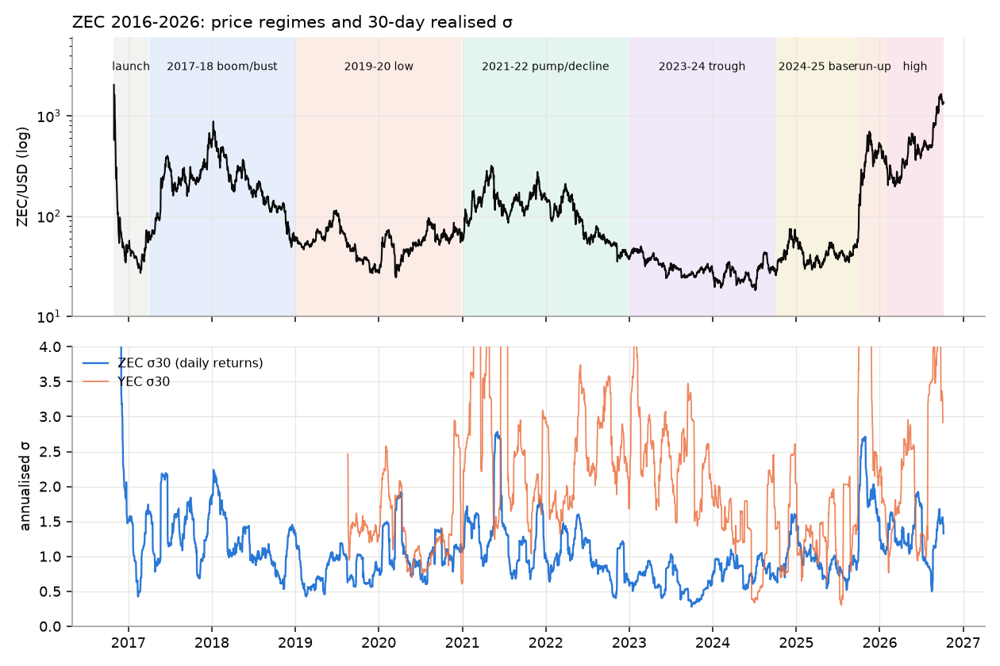
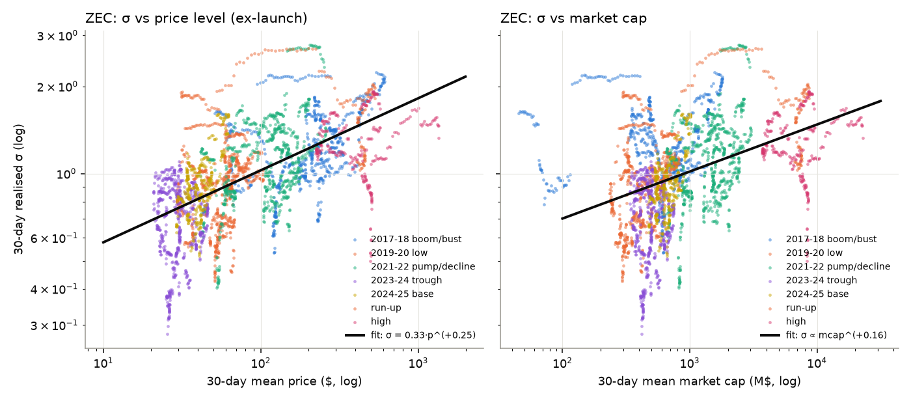
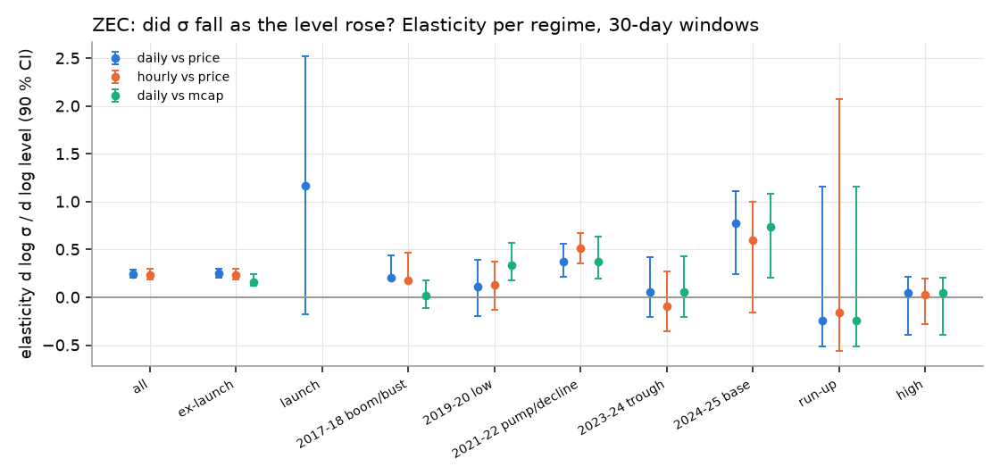
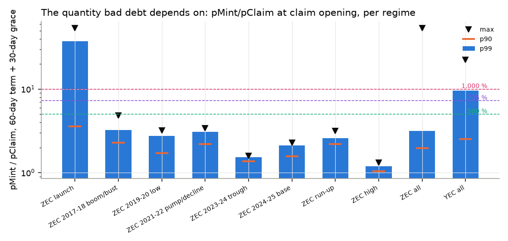
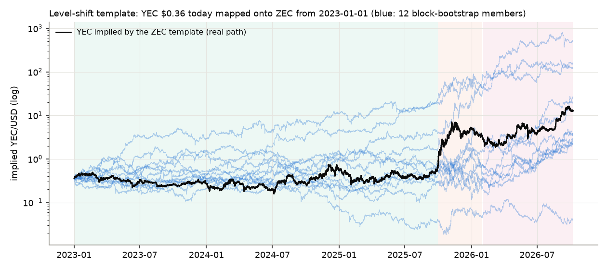
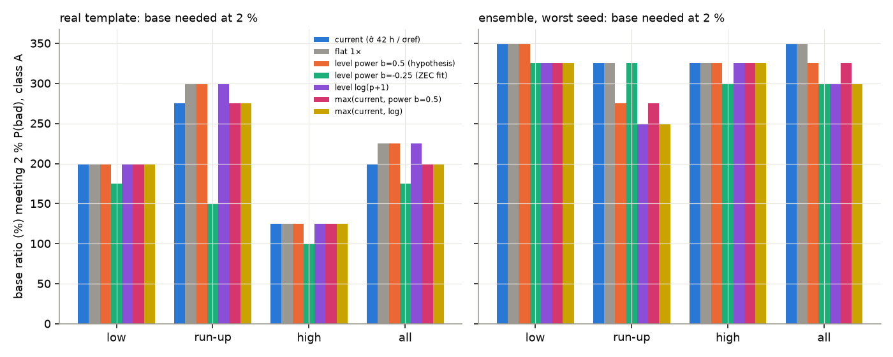
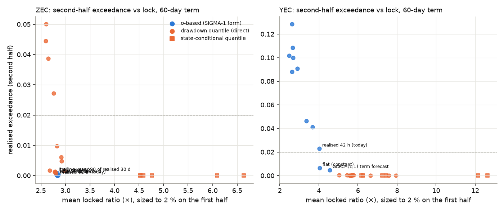

# Zcash as the level-shift template: does percentage volatility fall when the price rises, and what sizes collateral best per unit locked?

**Study of the owner direction of 2026-10-07.** YEC has never sustained a price above $1, so its own
history ([2026-10-volatility](../2026-10-volatility/README.md)) cannot test the hypothesis that
percentage volatility falls as price and market cap rise after a level shift. ZEC (same lineage, same
mining base) traded under $30–50 for years (2023-24) and rose to four figures in 2025-26, so it is the
reference. The owner's wider question (relayed 2026-10-07) is addressed in §3: **what is the best way
to measure, manage and limit YED's collateral risk** — any method, scored on two axes: coverage of
the realised next-term worst drawdown at 1/2/5 %, and the collateral locked.

**Status: STUDY, no decision.** Code: `src/ybcal/studies/zec_level_shift.py` (numpy/scipy, ≈ 2 min
on one core). Every table here is in [`tables.md`](tables.md) and the `*.csv` next to it; figures are
PNG next to this file. Nothing here changes a parameter.

## Data — the one authorised pull

`data/local/zec/` (gitignored; `SHA256SUMS` written and verified by the study before reading), fetched
2026-10-07 through the repo fetcher (`ybcal.data.fetch.HttpClient`, `parse_market_chart`,
`ybcal.data.venues.parse_cmc_historical`, `write_provenance`; a `.provenance.json` sidecar per file):

| file | source | span | rows | note |
|---|---|---|---|---|
| `zec-hourly-cg-90d.csv` (+`-mcap`) | CoinGecko `market_chart?days=90` (free tier, no key) | 2026-07-09 → 2026-10-07 | 2,161 hourly | **what the free tier allows hourly: 90 days**; `market_caps` kept |
| `zec-daily-cg-365d.csv` (+`-mcap`) | CoinGecko `market_chart?days=365&interval=daily` | 2025-10-07 → 2026-10-07 | 366 daily | the free tier stops at 365 days (HTTP 401 beyond) |
| `zec-daily-cmc.csv` (+`-mcap`) | CoinMarketCap data-api, daily, 13 chunks | **2016-10-30 → 2026-10-07** | 3,630 daily | full history, close + 24 h volume + `quote.marketCap` |
| `zec-hourly-cmc.csv` (+`-mcap`) | CoinMarketCap data-api, hourly, 119 chunks | **2017-01-01 → 2026-10-07** | 84,871 hourly | full hourly history; 0.9 % of hours are stale repeats |

The CMC and CoinGecko hourly series agree on their 90-day overlap (median |Δp/p| 0.07 %, return
correlation 0.97), so the long CMC series is used throughout, with the CoinGecko files as the check.
YEC is the frozen snapshot `data/local/frozen-20261004` (SHA256 verified, nothing re-pulled). Nothing
else was fetched.

**The actual ZEC path** (the owner's "under $30 for years, later ~$1,500" is approximately right):
launch spike $2,044 → $27 inside the first months (2016-10 → 2017-03, excluded from every fit as its
own regime); 2017-18 boom to $881 and bust; 2019-20 $25–114; 2021 pump to $319 and 2022 decline;
**2023-01 → 2024-09 trough, $18–50, median $29, market cap ≈ $0.5 bn**; 2024-10 → 2025-09 base
$26–75; **run-up 2025-10 → 2026-01, $74 → $698**; **high 2026-02 → 2026-10, $197–1,650, now
≈ $1,300, market cap ≈ $8 bn**. ZEC has not *sustained* $1,500: it touched $1,650 in 2026-Q3 and sits
at $1,300; the "high" regime is eight months old and its last 2–4 months are censored for the 60–120
day claim horizon.



## Verdict in one paragraph

**The hypothesis fails on ZEC as it failed on YEC, and more clearly.** Across ZEC's ten years
(ex-launch) realised σ is *higher* when the price is higher: elasticity `d log σ / d log p` = **+0.25**
(daily 30-day windows, 90 % block-bootstrap CI +0.21…+0.30, Spearman 0.63, R² 0.35; hourly +0.24,
CI +0.19…+0.30), and **+0.16** against market cap (CI +0.12…+0.25). The trough years at $29 were ZEC's
*calmest* (median 30-day σ 73 %), the run-up at $400 its most volatile (180 %), and the new high regime
at $465 sits at 124 % — above the trough, level with the 2017-18 boom at the same prices. Within the
high regime alone the level has no effect (b = +0.05, CI −0.40…+0.22). The bad-debt quantity itself
tells the same story: the worst `pMint/pClaim` over a 60-day term + 30-day grace was 1.6× in the trough,
3.2× in the run-up, 1.3× in the (still rising, censored) high regime, 4.8× in 2017-18 — the risk tracked
the *episode*, not the level. **A price- or cap-level state variable does not earn its place**: on the
ZEC template, level rules in the hypothesised direction lock more in the low regime where the risk was
lowest and collapse to the floor in the run-up where it was highest, and a level rule in the *fitted*
direction (σ ∝ p^+0.25) is just a worse-timed σ estimate. What ZEC does show is that a chain whose
volatility is ZEC-like needs **200–350 %** class-A collateral at 2 % tolerance, not YEC's 400–500 %
(ZEC's worst need since 2017 is 5.4×, YEC's 22×). On the owner's wider question (§3): **drawdown
quantiles of `pMint/pClaim` beat every σ estimator on ZEC**, a flat ratio beats all of them on YEC's
30–60-day terms, today's 42-hour σ̂ is the noisiest candidate on both, and **the levers that move the
lock most are not estimators at all but the claim threshold with a short claim delay** (in-term
liquidation at θ = 125 %, d = 24 h would meet 2 % on YEC at a 150 % flat ratio versus 375 % today —
with the slippage/depth caveat in §3.4) and the term length (30-day terms need 13 % less than 90-day on
ZEC, 19 % less on YEC).

## 1. ZEC: σ vs price level and vs market cap

Method as in the YEC study: log returns; rolling 30/60/90-day σ annualised; the level is the window's
geometric mean of price (or of market cap from `quote.marketCap`); OLS of log σ on log level with a
moving-block bootstrap (block = one window) for the 90 % CI; `b | time` adds a linear time trend.





| series | w | period | n | Spearman | **b** | 90 % CI | b \| time | R² | median σ |
|---|---|---|---|---|---|---|---|---|---|
| ZEC daily vs price | 30 d | ex-launch (2017-04 →) | 3,477 | +0.63 | **+0.249** | +0.21 … +0.30 | +0.247 | 0.35 | 98 % |
| ZEC daily vs price | 90 d | ex-launch | 3,477 | +0.74 | +0.255 | +0.22 … +0.33 | +0.252 | 0.49 | 107 % |
| ZEC hourly vs price | 30 d | ex-launch | 83,445 | +0.58 | **+0.237** | +0.19 … +0.30 | +0.229 | 0.32 | 105 % |
| **ZEC daily vs market cap** | 30 d | ex-launch | 3,477 | +0.44 | **+0.162** | +0.12 … +0.25 | +0.243 | 0.16 | 98 % |
| ZEC daily vs price | 30 d | 2017-18 boom/bust | 640 | +0.41 | +0.207 | +0.20 … +0.44 | | 0.14 | 119 % |
| ZEC daily vs price | 30 d | 2019-20 low | 731 | +0.22 | +0.108 | −0.19 … +0.39 | | 0.01 | 93 % |
| ZEC daily vs price | 30 d | 2021-22 pump/decline | 730 | +0.45 | +0.377 | +0.22 … +0.56 | | 0.25 | 112 % |
| ZEC daily vs price | 30 d | 2023-24 trough | 639 | −0.02 | +0.052 | −0.21 … +0.42 | | 0.00 | 73 % |
| ZEC daily vs price | 30 d | 2024-25 base | 365 | +0.50 | +0.778 | +0.25 … +1.12 | | 0.39 | 89 % |
| ZEC daily vs price | 30 d | run-up | 123 | −0.43 | −0.242 | −0.51 … +1.16 | | 0.30 | 180 % |
| ZEC daily vs price | 30 d | high | 249 | +0.12 | +0.051 | −0.40 … +0.22 | | 0.01 | 124 % |
| ZEC daily vs price | 30 d | band < $50 | 1,241 | +0.26 | +0.418 | +0.16 … +0.75 | | 0.09 | 81 % |
| ZEC daily vs price | 30 d | band $50–300 | 1,841 | +0.43 | +0.274 | +0.20 … +0.37 | | 0.18 | 108 % |
| ZEC daily vs price | 30 d | band > $300 | 395 | +0.27 | +0.172 | −0.07 … +0.57 | | 0.03 | 146 % |
| YEC daily vs price | 30 d | all (2019-26) | 2,604 | +0.18 | +0.114 | +0.03 … +0.22 | +0.128 | 0.04 | 184 % |

All 80 fits are in `level_fits.csv`. Reading:

- **Sign.** Positive on the full history, positive or zero in every regime but the four-month run-up
  (−0.24, CI spanning zero: within the run-up σ rose first and the price followed). The hypothesis
  predicts a negative b everywhere, and most of all across the trough → high transition, where the
  measured regime medians go **73 % → 180 % → 124 %**.
- **Strength.** ZEC's relation is much tighter than YEC's (R² 0.35 vs 0.04) — ZEC's history is long
  enough for the pattern to be unambiguous. The sign is the same.
- **Market cap** gives the same answer with a smaller slope (+0.16): cap moved with price (supply is
  smooth), and the high-cap regime ($8 bn) is more volatile than the $0.5 bn trough.
- **Deciles** (`deciles_price_daily_30d.csv`): median 30-day σ **73 %** in the lowest price decile
  ($21–30) rising monotonically to **151 %** in the highest ($331–1,351); by market cap 92 % in the lowest
  decile ($45–347 M) to 135 % in the highest ($3–23 bn). Nothing resembles "1 % at $100": at $100–140
  ZEC's σ was 99 %, at $330+ it was 151 %.
- **Time control** leaves b unchanged (+0.25 → +0.25): "later = calmer" is not what the data say
  either.

**Regime σ summary** (`regime_sigma.csv`; YEC for scale):

| regime | median $ | σ30 daily median | p90 | σ30 hourly median | p90 |
|---|---|---|---|---|---|
| 2017-18 boom/bust | 214 | 119 % | 187 % | 134 % | 231 % |
| 2019-20 low | 55 | 93 % | 136 % | 89 % | 127 % |
| 2021-22 pump/decline | 118 | 112 % | 162 % | 110 % | 176 % |
| **2023-24 trough** | **29** | **73 %** | 96 % | 71 % | 114 % |
| 2024-25 base | 41 | 89 % | 127 % | 107 % | 146 % |
| **run-up** | **405** | **180 %** | 266 % | 199 % | 256 % |
| **high** | **465** | **124 %** | 172 % | 110 % | 177 % |
| YEC 2019-26 | 0.10 | 184 % | 344 % | 361 % | 641 % |

### 1.1 The bad-debt quantity directly: `pMint / pClaim` per regime

`drawdowns.csv`, daily series; "claim-open" is the G3 horizon (term T + 30-day grace), "term end" is
T alone. The vault is bad iff `ratio_eff < pMint/pClaim`.



| series / regime | T | p50 | p90 | **p99** | **max** | share > 5× | share > 7.25× |
|---|---|---|---|---|---|---|---|
| ZEC 2017-18 boom/bust | 60 d | 1.31 | 2.28 | 3.24 | 4.84 | 0 | 0 |
| ZEC 2019-20 low | 60 d | 0.86 | 1.71 | 2.74 | 3.19 | 0 | 0 |
| ZEC 2021-22 pump/decline | 60 d | 1.13 | 2.19 | 3.07 | 3.41 | 0 | 0 |
| **ZEC 2023-24 trough** | 60 d | 1.04 | 1.37 | **1.54** | **1.60** | 0 | 0 |
| ZEC 2024-25 base | 60 d | 0.82 | 1.56 | 2.11 | 2.28 | 0 | 0 |
| **ZEC run-up** | 60 d | 1.47 | 2.19 | **2.58** | **3.15** | 0 | 0 |
| **ZEC high** (censored after 2026-07) | 60 d | 0.53 | 1.04 | 1.20 | 1.32 | 0 | 0 |
| ZEC all ex-launch | 30 / 60 / 90 d | 1.0 | 1.8 / 2.0 / 2.1 | 2.6 / 3.2 / 3.1 | 2.8 / 4.8 / 3.3 | 0 | 0 |
| ZEC launch 2016-17 | 60 d | 0.64 | 3.60 | 37.5 | 53.5 | 9.2 % | 6.5 % |
| **YEC all 2019-26** | 30 / 60 / 90 d | 1.07 | 2.2 / 2.5 / 2.7 | **7.9 / 9.7 / 13.6** | **11.6 / 22.4 / 19.6** | 1.6 / 2.2 / 3.1 % | 1.2 / 1.6 / 2.4 % |

Three things follow. (i) **Since 2017 no ZEC vault at ≥ 500 % would ever have been bad**; the 60-day
p99 need is 3.2× and the max 4.8× (2018). YEC's p99 is 9.7× and max 22×: the two coins differ by a
factor 3 in the tail, and that difference — not the price level — is why YEC needs 400–500 % where
ZEC needs 200–350 %. (ii) The trough *was* the safest regime (max 1.6×) and the run-up the most
dangerous (3.2×, p99 2.6×): **the risk moved with the episode, up when the price went up**. (iii) The
launch months (a listing at $2,000 collapsing to $27) are the only ZEC period with YEC-like tails;
they are the "price has no history yet" regime, which is the opposite of a high-cap plateau.

## 2. Level-shift simulation for YEC

**Template.** ZEC's hourly percentage path from the start of its trough, `TEMPLATE_T0 = 2023-01-01`
($37.3) to 2026-10-07 ($1,327; ×35.5), with YEC's last frozen price **$0.361** mapped onto its start:
the implied YEC path ends at **$12.8** (max $16.3). Coarse regimes by date: **low** 2023-01 → 2025-09,
**run-up** 2025-10 → 2026-01, **high** 2026-02 →. **Ensemble**: 24 members, a within-regime moving-block
bootstrap of the hourly log returns (7-day blocks, regime lengths kept), so seed spread exists: the
members end between $0.54 (p10) and $160 (p90), median $7.5.



**Rules** (multiplier per mint hour, `ratio_eff = base · mult // 10^4`, H-3 pins σref 18,000 /
cap 47,500 bps), anchored at YEC's own state today — p₀ = $0.361 and σ̂₀ = **188 %**, the median SIGMA-1
σ̂ (42 h kernel) over YEC's last 90 frozen days — so every level rule demands at today's price exactly
what the chain demands today and then follows the level:

| rule | multiplier |
|---|---|
| `current` | SIGMA-1 today: clamp(σ̂₄₂ₕ / σref, 1, cap) on the path |
| `flat 1×` | 1 |
| `level power b = 0.5 (hypothesis)` | σ̂(p) = σ̂₀ · (p/p₀)^(−0.5) — the owner's direction |
| `level power b = −0.25 (ZEC fit)` | σ̂(p) = σ̂₀ · (p/p₀)^(+0.25) — the direction ZEC's data give |
| `level log(p+1)` | σ̂(p) = σ̂₀ · log(1+p₀)/log(1+p) — the owner's log(p+1) shape |
| `max(current, …)` | conservative blends |

The ZEC elasticity is −b = +0.25, so a fitted "b" is negative; the hypothesis rule uses b = 0.5 as the
YEC study did, and the fitted-sign rule is shown for honesty. Scoring: class A (30–90-day terms,
16-term grid, 30-day grace) with the G3 bad-debt definition (`vol_price_level.backtest`,
`p_bad_debt_fast`'s test), the smallest lattice base meeting each tolerance per regime, and the
time-average effective ratio minters would have faced (`levelshift_*_required.csv`; the fixed-base
P(bad) tables at 200–1,000 % are in `levelshift_real.csv` / `levelshift_ensemble.csv`: **every rule has
P(bad) = 0 at ≥ 350 % on the real template** and at 500 % in every ensemble member but one).



**Class A base needed at 2 % tolerance, and the lock it implies (real template / ensemble worst seed)**

| regime | realised need p99 / max | current (σ̂ 42 h) | flat 1× | hypothesis b = 0.5 | log(p+1) | ZEC-fit b = −0.25 |
|---|---|---|---|---|---|---|
| **low** (2023-01 → 2025-09) | 1.95× / 2.83× | 200 % → eff 202 % | **200 %** | 200 % → eff **226 %** (p90 264 %) | 200 % → eff **244 %** (p90 315 %) | 175 % → eff 182 % |
| **run-up** (2025-10 → 2026-01) | 3.07× / 3.55× | 275 % → eff 326 % (p90 439 %) | **300 %** | 300 % → eff 300 % (at floor) | 300 % → eff 300 % (at floor) | 150 % → eff 280 % |
| **high** (2026-02 →, censored) | 1.30× / 1.48× | 125 % → eff 128 % | **125 %** | 125 % (at floor) | 125 % (at floor) | 100 % → eff 185 % |
| **all** | 2.31× / 3.55× | 200 % → eff 206 % | **225 %** | 225 % → eff 248 % | 225 % → eff 263 % | 175 % → eff 216 % |
| ensemble worst, low | — / 5.25× | 350 % | 350 % | 350 % → eff 414 % | 325 % → eff 449 % | 325 % → eff 388 % |
| ensemble worst, run-up | — / 6.24× | 325 % → eff 377 % | 325 % | 275 % → eff 323 % | 250 % → eff 348 % | 325 % → eff 491 % |
| ensemble worst, high | — / 3.87× | 325 % | 325 % | 325 % → eff 362 % | 325 % → eff 409 % | 300 % → eff 583 % |
| ensemble worst, all | — / 6.24× | 350 % → eff 358 % | **350 %** | 325 % → eff 381 % | 300 % → eff 409 % | 300 % → eff 399 % |

Per regime the realised need and what each rule locked say the same thing from both sides:

- In the **low** regime (the "YEC today" state) the need was the lowest of the three (p99 1.95×) yet
  the hypothesis and log rules lock the most there (226–244 % average against a 200 % need), because
  that is where they are above the floor. In the **run-up**, where the need peaked (3.07×), both are
  at the floor: they have already decided the asset is "safe now". The ZEC-fit rule (σ rising with p)
  does the opposite and gets the run-up right for the wrong reason — it is a level proxy for a σ
  estimate, and a σ estimate (even today's) does it directly.
- **Today's 42-hour σ̂ adds almost nothing on a ZEC-like path**: its multiplier averages 1.01–1.19
  (σ̂ rarely exceeds σref 180 %), so it is a flat rule with noise; it saves 25 bps of base in the run-up
  at the cost of a p90 lock of 439 %.
- The **ensemble** widens everything (worst-seed need 6.2× in the run-up, 5.3× even in the low
  regime): with the bootstrap's heavier paths a flat **350 %** meets 2 % in the worst seed, and the
  level rules buy 25–50 bps of base back only by locking 10–30 % more on average. No rule separates
  from flat by more than the lattice step.
- On **ZEC's own prices** across all cycles (`levelshift_zec_full_required.csv`, anchored at the trough
  $29 / σ̂ 62 %): flat needs 300 % in 2017-18 and 2021-22, 250 % in 2019-20, 175 % in the trough, 125 %
  in the high regime, **275 % on the whole 2017-26 history** at 2 % (need p99 2.9×, max 5.4×). The
  current rule needs the same 275 % with a 286 % average lock. The level rules are at the floor in
  every regime but the trough.

**Verdict on the hypothesis under the ZEC template:** rejected. When ZEC moved from its low regime to
its high one, its percentage volatility **rose** (73 % → 180 % through the run-up, 124 % on the
plateau so far) and the 60-day drawdown tail rose with it (max 1.6× → 3.2×); on the plateau the tail
has so far been small (1.3×) but that regime is eight months old, rising, and censored. Assuming YEC
follows the same percentage path, the collateral need does not fall as the price rises until the
plateau — and a rule that lowers the lock *as a function of the price* lowers it during the run-up,
the worst time. What *would* fall is the whole level of need if YEC's tails became ZEC-like (22× → 5×),
and that is a property of depth and holder base, which a rule cannot read from the price.

### 2.1 Feasibility note (unchanged from the YEC study)

A price-level term would be a new consensus input to MINT-5 (`levelMultBps(pMint)` as a pinned
piecewise-linear integer table; both node lines; new hashed parameter group; golden vectors; wallet
quotes over `yed_getinfo`), i.e. a YED-module rule change on the `upgrade/vault` line and a four-part
check (AGENTS.md rule 4) — against a benefit that neither coin's data show. Not recommended.

## 3. Measuring, managing and limiting the collateral risk: the candidates, ranked

The owner's goal (relayed 2026-10-07) is the best way to measure, manage and limit YED's collateral
risk, by any method. Every candidate below is scored on the same two axes, on both ZEC (2017-04 →,
hourly) and YEC (frozen hourly): **coverage** — the share of mint hours whose realised
`pMint / pClaim` at claim opening (term T + 30-day grace, T = 30/60/90 d) exceeded the lock — against a
1/2/5 % tolerance, and **the collateral locked** — the time-average ratio. Each candidate is sized by one
scalar `k` (geometric lattice) on the **first half** of the series to hit the tolerance, then scored
**on the second half** (out of sample); in-sample rows are in `estimators.csv`. A candidate "covers"
when its second-half exceedance is ≤ 1.25 × tolerance; covering candidates rank by lock, the rest by
exceedance. `ranking.csv` has every (series, term, tolerance); `fig7_estimators.png` plots the 60-day /
2 % frontier.

**Candidates.** *σ-based* (sized through SIGMA-1's clamp(σ̂/σref) form and a proportional
`k·σ̂·√τ` form): realised σ over 42 h (today's kernel), 7, 30, 60, 90 d; EWMA of hourly squared
returns, half-life 1, 7, 30 d; GARCH(1,1) on daily returns (scipy QML with variance targeting, fitted
on the first 40 % of days, term variance = mean of the k-step-ahead variances); trailing-year p90 of
realised 30-day σ; flat. *Drawdown-based* (sized directly): historical VaR (p95/p99 quantile) and
CVaR (mean beyond the quantile) of the realised `pMint/pClaim` for the same term, expanding, 2-year and
1-year windows — all causal (only claims that have already opened). *State-conditional*: the same p99
VaR/CVaR restricted to past starts in the current state — price-level tercile (trailing 2 years),
90-day momentum band (< 0.8, 0.8–1.25, > 1.25), realised-σ30 tercile, and for ZEC the turnover
tercile (30-day volume / price). The levers that are not estimators — term length, claim threshold,
claim delay — are in §3.3–3.4.



### 3.1 The ranking (out of sample, 2 % tolerance; full tables in `ranking.csv`)

**ZEC** (second half = 2022-01 → 2026-10; tails ≤ 5.4×):

| T | rank | candidate | mean lock | p90 lock | exceedance |
|---|---|---|---|---|---|
| 30 d | 1 | EWMA half-life 30 d (prop) | **2.29×** | 3.26× | 1.8 % |
| 30 d | 2 | historical VaR p95 of pMint/pClaim (2 y) | 2.31× | 2.84× | 2.1 % |
| 30 d | 5 | historical VaR p95 (expanding) | 2.37× | 2.46× | 0.5 % |
| 30 d | 8 | **flat** | 2.39× | 2.39× | 0.3 % |
| 30 d | 13 | **realised 42 h (today)** | 2.42× | 2.36× | 0.4 % |
| 60 d | 1 | trailing-year p90 of realised 30 d (prop) | **2.50×** | 4.06× | 0.4 % |
| 60 d | 2–5 | realised 60 d, EWMA 30 d, CVaR p99 (expanding), realised 90 d | 2.66–2.68× | 2.75–3.95× | 0.1–1.4 % |
| 60 d | 10 | **flat** | 2.80× | 2.80× | 0.1 % |
| 60 d | 14 | **realised 42 h (today)** | 2.84× | 2.77× | 0.0 % |
| 90 d | 1 | trailing-year p90 of realised 30 d (prop) | **2.69×** | 4.43× | 0.3 % |
| 90 d | 2–3 | realised 60 d, EWMA 30 d (prop) | 2.74–2.75× | 3.9× | 0.1–0.4 % |
| 90 d | 7 / 9 | **flat** / **realised 42 h (today)** | 2.94× / 2.94× | 2.94× / 2.87× | 0.2 / 0.1 % |
| 60 d, 5 % | 1 | trailing-year p90 of realised 30 d | 2.13× | 3.46× | 3.5 % |
| 60 d, 5 % | 2–5 | historical VaR/CVaR p95/p99 (1 y) | 2.20–2.26× | 3.2–3.3× | 3.7–6.0 % |
| 60 d, 5 % | 15 / 17 | flat / realised 42 h | 2.47× / 2.51× | | 0.4 / 0.2 % |

**YEC** (second half = 2023-06 → 2026-10; tails to 22×):

| T | rank | candidate | mean lock | p90 lock | exceedance |
|---|---|---|---|---|---|
| 30 d | 1 | **flat** | **3.29×** | 3.29× | 1.8 % |
| 30 d | 2 | GARCH(1,1) term forecast | 3.70× | 5.16× | 1.6 % |
| 30 d | 3–5 | historical CVaR p99 / CVaR p95 / VaR p99 (1 y) | 3.71–3.73× | 4.1–4.3× | 0.2–0.5 % |
| 30 d | 21 | **realised 42 h (today)** | 3.11× | 6.06× | **6.4 % — fails** |
| 60 d | 1 | realised 42 h (today) | 4.02× | 7.98× | 2.3 % |
| 60 d | 2 | **flat** | **4.04×** | 4.04× | 0.7 % |
| 60 d | 3 | GARCH(1,1) term forecast | 4.56× | 6.32× | 0.5 % |
| 60 d | 4 | historical VaR p95 (2 y) | 5.04× | 6.17× | 0.1 % |
| 90 d | 1 | realised 7 d | **3.67×** | 7.17× | 0.6 % |
| 90 d | 2 | EWMA half-life 1 d | 3.97× | 7.86× | 0.5 % |
| 90 d | 3 | realised 42 h (today) | 4.39× | 8.77× | 0.4 % |
| 90 d | 23 | **flat** | 3.69× | 3.69× | **3.5 % — fails** |
| 60 d, 5 % | 1 | **flat** | 3.07× | 3.07× | 3.6 % |
| 60 d, 5 % | 21 | realised 42 h (today) | 2.92× | 5.80× | **8.8 % — fails** |

### 3.2 What the ranking says, plainly

1. **Today's 42-hour σ̂ is the worst-behaved candidate on both coins.** On ZEC it never leaves the
   floor (mean multiplier 1.03) and ranks 9th–14th: a flat rule with jitter. On YEC it *fails coverage*
   out of sample at 30 d (6.4 % vs 2 %) and at 5 % (8.8 %), and where it covers it does so with a p90
   lock of 8–10× — minters in volatile hours pay for the calm hours it under-protects. The YEC study's
   §4 finding stands and is now confirmed on a second coin.
2. **On ZEC-like tails, slow σ (30–90-day realised, EWMA 30 d, trailing-year p90) and drawdown
   quantiles both beat flat by 5–15 % of lock at equal coverage**; the drawdown quantiles have the
   tighter p90 (2.5–3.2× vs 3.3–4.7×), i.e. they are the fairer rule to a minter, and the CVaR variant
   is never worse than the VaR at the same window. The gain is modest because ZEC's tail is thin: the
   whole ranking spans 2.3–3.0× at 60 d.
3. **On YEC's tails nothing beats flat at 30–60 days.** YEC's crashes (2021-11, 2025-11) came from
   calm, so every backward-looking signal — σ or drawdown — is low exactly before them; a 1-year
   drawdown quantile needs 3.7× at 30 d where flat needs 3.3×, GARCH 3.7×. Only at 90 days do the
   fast σ signals pull ahead (realised 7 d 3.67× vs flat failing at 3.69×), because a 120-day horizon
   catches the crash *inside* the window of mints made after it starts.
4. **State conditioning does not earn its place.** Conditional quantiles by price level, momentum, σ
   tercile or turnover rank 15th–25th on both coins (4.5–12× lock on YEC, 4.5–6.6× on ZEC): splitting the
   history into thirds leaves each state with too few tail events, so the conditional p99 is wider,
   not sharper. The level-shift test of §2 says the same from the other side: **a price- or cap-level
   state variable does not improve the forecast of the next-term drawdown**.
5. **GARCH is honest but not better.** The Gaussian QML on both coins runs to the IGARCH boundary
   (α → 1, β → 0: tomorrow's variance = today's squared return, log-likelihood −4,570 vs −4,188 for the
   constrained fit on ZEC); constrained with variance targeting it lands at α = 0.80, β = 0.20,
   persistence 0.999, i.e. a very persistent EWMA of daily squared returns. It ranks 2nd–3rd on YEC at
   30–60 d but locks 12–15 % more than flat, and it is not consensus arithmetic (`summary.json`
   `garch`).
6. **The per-unit-lock winner depends on which tails you believe.** If YED's future is ZEC-like (the
   premise of the level-shift question), a **1-year CVaR p99 of `pMint/pClaim`** or a **trailing-year
   p90 of realised 30-day σ** gives the best coverage per unit locked with the fairest distribution of
   locks. If YEC's own tails persist, **a flat class-A ratio is the best estimator** — and the lock is
   then decided by the levers below, not by the estimator.

### 3.3 Term length as a risk limit

From `ranking.csv` (flat, 2 %, second half): ZEC needs **2.39× at 30 d, 2.80× at 60 d, 2.94× at
90 d**; YEC **3.29× / 4.04× / 3.69× (fails)**. The 30-day term needs 13 % (ZEC) to 19 % (YEC) less
collateral than the longer ones, and on YEC it is the only term where flat meets 1 % without
failing. The tolerance study's §0 reading (30-day class A meets 1 % at 725 % on every window) is
consistent. **Capping class A at 30 or 45 days is a parameter change** (`CLASS_TERMS[A]`, the term
bounds are registry parameters, no new consensus arithmetic) and is the cheapest lever in this report.

### 3.4 Management levers: the claim threshold and the claim delay

Today a vault can only be claimed after `lockHeight + grace`: whatever happens inside the term, the
solvency test is at claim opening 60–120 days after the mint, and that is why the lock must cover a
60–120-day drawdown. If instead a vault became **claimable during the term when its collateral falls
below `claimThresholdBps` (θ)**, with the claim completing after a delay **d** (the attestor arming /
cancel delay, `attestArmDelay` is 24 h at mainnet), the lock would only have to cover the drop from θ
to 100 % *within d*, plus the claim-opening test for vaults that never crossed. `levers.csv`
(`lever_study`): the smallest **flat** ratio meeting each tolerance, with the claimant acting at the
first crossing at the market price (no slippage, no depth limit, no claimant incentive modelled).

| series | T | today (θ = 100 %, no in-term claims) | θ 110 %, d 24 h | θ 110 %, d 72 h | θ 125 %, d 24 h | θ 125 %, d 72 h | θ 150 %, d 72 h | θ 150 %, d 168 h |
|---|---|---|---|---|---|---|---|---|
| ZEC | 30 d | 2.50× | 2.00× | 2.25× | 1.25× | 2.25× | 1.25× | 1.50× |
| ZEC | 60 d | 2.75× | 2.25× | 2.25× | 1.25× | 2.25× | 1.25× | 1.50× |
| ZEC | 90 d | 2.75× | 2.50× | 2.50× | 1.25× | 2.25× | 1.25× | 1.50× |
| **YEC** | 30 d | **3.25×** | 2.25× | 2.50× | **1.50×** | 1.75× | 1.50× | 1.75× |
| **YEC** | 60 d | **3.75×** | 2.75× | 2.75× | **1.50×** | 1.75× | 1.50× | 1.75× |
| **YEC** | 90 d | **4.00×** | 2.75× | 2.75× | **1.50×** | 1.75× | 1.50× | 1.75× |

(2 % tolerance; 1 % and 5 % in the CSV read the same.) **This is the largest lever in the report by a
factor of two**: on YEC's own history, in-term liquidation at θ = 125 % with a 24-hour claim delay
meets 2 % at a **150 %** flat ratio against **375 %** today at 60 days; at θ = 150 % even a 7-day delay
holds at 175 %. The reason is arithmetic, not modelling: a 60–120-day worst drop of 22× becomes a
1–7-day worst drop of 1.3–1.5×. The caveats are real and are what the owner would be buying: the
claimant must exist and act (a claimant-incentive question, D-RD-COL-6), the liquidation price is the
oracle's pClaim not a market fill (YEC's depth is thin; a 1.25× threshold with a 24-hour delay leaves
little margin for divergence), and a wave of in-term claims in a crash is itself a sell-pressure
event. Soft cap and the emergency ratio are not in this harness: the supply cap bounds the *size* of
any bad debt, not its probability per vault, and is complementary.

### 3.5 What each method would require in consensus (both node lines; same format as the YEC study §3)

| method | where it lands | what changes |
|---|---|---|
| **Flat class-A ratio** (today's `baseRatioBps[0]` with `sigmaMultMaxBps` → 10⁴, which pins the multiplier at 1×) | parameter pin | nothing new; H-3 and the tolerance study size it |
| **Shorter class-A term** (30–45 d) | parameter pin | `CLASS_TERMS[A]` upper bound; wallets quote it over `yed_getinfo` |
| **Longer / slower σ̂** (realised 30–90 d, trailing p90) | parameter pin + sizing knob | `volWindow` 2016 → 30,240–60,480 (within the registry's bounds to 8,064 only — a bound change), `sigma_mult_at = "p90"` is a ybcal policy knob; the kernel is unchanged |
| **EWMA σ̂** | SIGMA-1 kernel change | integer EWMA of squared `volStep` returns (one 64-bit state per block, exact fixed-point λ), new hashed parameters (λ), golden vectors; YED-module rule change on `upgrade/vault` |
| **Drawdown VaR / CVaR of `pMint/pClaim`** | SIGMA-1 replaced by a drawdown kernel | the node already holds the price snapshots; a 1-year quantile over 8,760 hourly `p_s/p_{s+H}` ratios per term class is an integer selection problem (sortable window, or a fixed-bucket histogram of ratios with a running count — O(1) per block, 64-bit); new state (the histogram), new hashed parameters (window, quantile, CVaR on/off), per-class H; the largest consensus change in this table short of the levers, and the best estimator only on ZEC-like tails |
| **GARCH / fitted models** | not consensus arithmetic | floating-point MLE; could only enter as pinned per-release constants, which makes it a flat ratio with a story |
| **State-conditional quantiles** (price level, cap, momentum, turnover) | SIGMA-1 + state classifier | adds a state variable and per-state histograms; the data do not support it (§3.2 point 4, §2) |
| **Price-level term** (`levelMultBps(pMint)`) | MINT-5 rule change | as the YEC study §3; rejected by both coins' data |
| **In-term claims at θ with delay d** | RED-4 / claim-path rule change | vaults become claimable before `lockHeight + grace` when `collateral · pClaim < θ · debt`; `claimThresholdBps` and `attestArmDelay` exist, the *timing* rule does not; interacts with the claimant incentive, divergence halts and the emergency ratio; the biggest lever and the biggest design change |

### 3.6 Recommendation for the owner's decision (study, not a decision)

1. **Drop the price-level idea.** Two coins, ten plus six years, the same sign: σ rises with the price.
2. **The estimator question is second-order to the levers.** On YEC's tails a flat ratio is the best
   estimator at 30–60 days; on ZEC-like tails a 1-year CVaR of `pMint/pClaim` or a trailing-year p90 of
   realised σ saves 5–15 % of lock. Neither moves the lock the way the term length (−13 to −19 %) or
   in-term liquidation (−50 to −60 %) do.
3. **If a consensus change is on the table at all, spend it on the claim path, not the estimator**: an
   in-term claim at θ = 125–150 % with a 1–3-day delay is what turns a 120-day drawdown problem into a
   1–3-day one. It needs the claimant-incentive and depth questions answered first; this report gives
   the collateral side of that trade.
4. Meanwhile the cheapest moves are parameter pins: a flat (or near-flat) class-A ratio sized by the
   tolerance study at the owner's 1–5 %, and a shorter class-A term.

## Reproduce

```bash
cd yb-calibration            # or the wt/calib-study worktree
(cd data/local/zec && shasum -a 256 -c SHA256SUMS)              # the study also checks before reading
PYTHONPATH=src nice -n 15 .venv/bin/python -m ybcal.studies.zec_level_shift \
    --zec-dir data/local/zec --yec-dir data/local/frozen-20261004 --out docs/reports/2026-10-zec
# ≈ 2 min on one core; --reps N (bootstrap CI replications, default 300), --seeds N (ensemble, 24),
# --no-figures
```

The pull itself (done once, 2026-10-07; **do not repeat** — the owner's no-re-pull rule is back in
force) used the repo fetcher's `HttpClient` / `parse_market_chart` / `parse_cmc_historical` /
`write_provenance` with the CoinGecko URLs `coins/zcash/market_chart?vs_currency=usd&days=90` and
`…&days=365&interval=daily`, and CoinMarketCap `historical?id=1437&convertId=2781&interval=daily|hourly`
chunked as `ybcal.data.venues.fetch_cmc_history` does (300 / 30-day chunks), keeping `market_caps` /
`quote.marketCap` into the `-mcap.csv` sidecars; the provenance JSONs list every URL.

Outputs: `summary.json`, `tables.md`, `regimes.csv`, `level_fits.csv`, `regime_sigma.csv`,
`deciles_price_daily_30d.csv`, `deciles_mcap_daily_30d.csv`, `drawdowns.csv`, `levelshift_real.csv`,
`levelshift_real_required.csv`, `levelshift_ensemble.csv`, `levelshift_ensemble_required.csv`,
`levelshift_zec_full.csv`, `levelshift_zec_full_required.csv`, `estimators.csv`, `ranking.csv`,
`levers.csv`, `fig1`–`fig7` PNG.

Caveats: one real ZEC path and one real YEC path (the ensemble is a block bootstrap of the template, not
a model); CMC hourly candles are an aggregate with 0.9 % stale hours; the ZEC "high" regime is eight
months old and censored for the longer horizons; `pMint` is the market price (ideal oracle) and the
lever study liquidates at the oracle price with no depth, slippage or claimant behaviour; out-of-sample
sizing uses a single split (first half → second half), so the YEC second half contains exactly one
crash (2025-26) and the ranking there is a one-event verdict.
